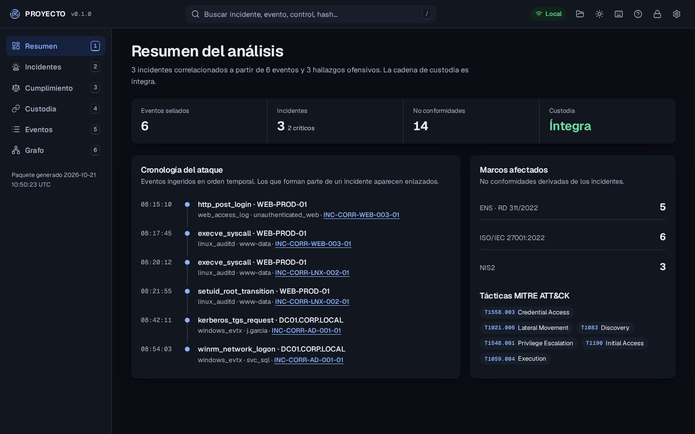
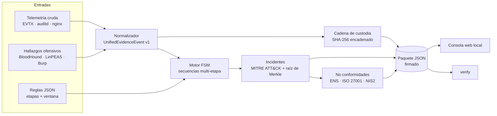
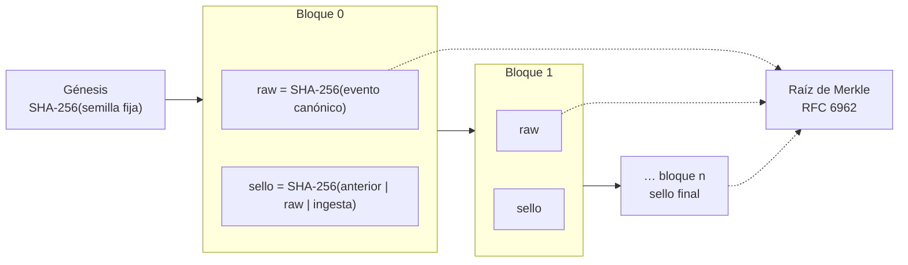
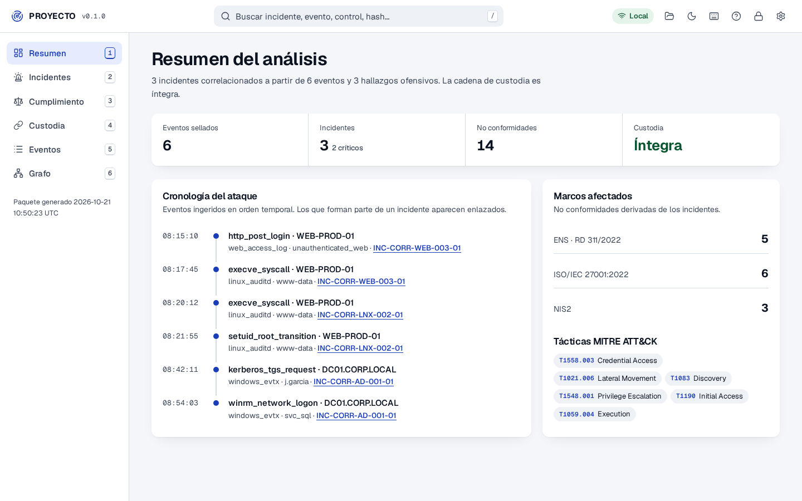
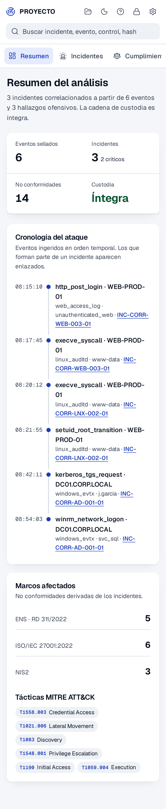
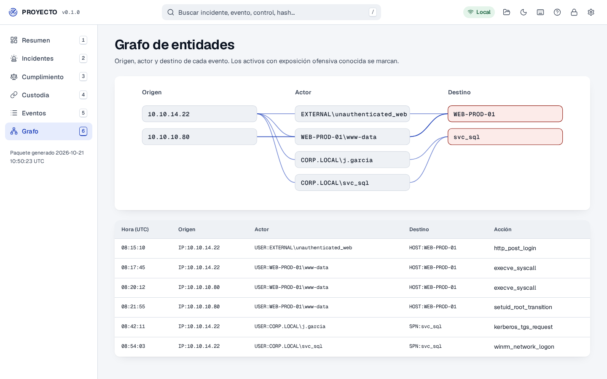
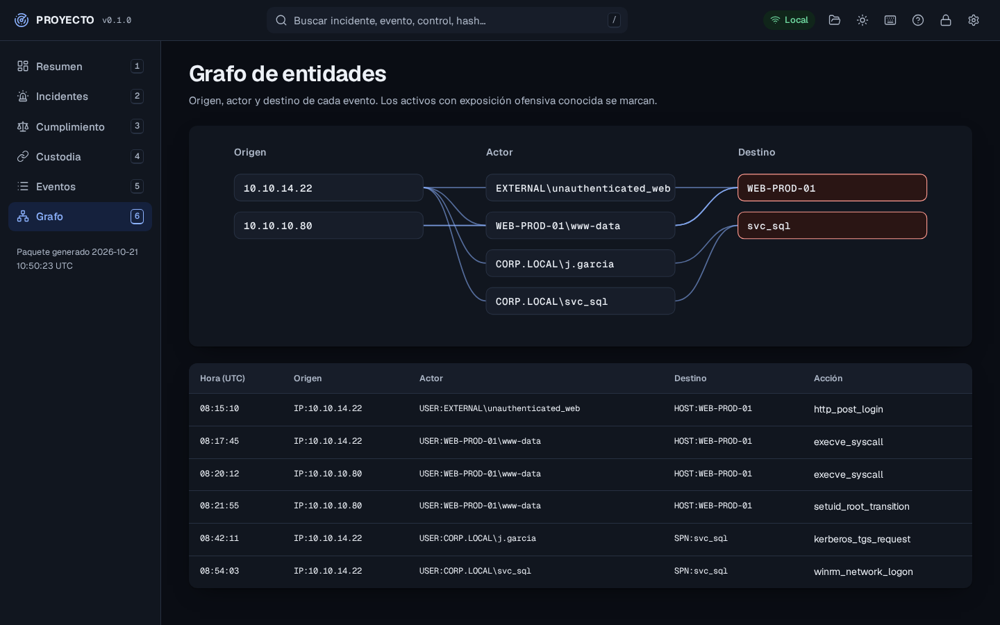
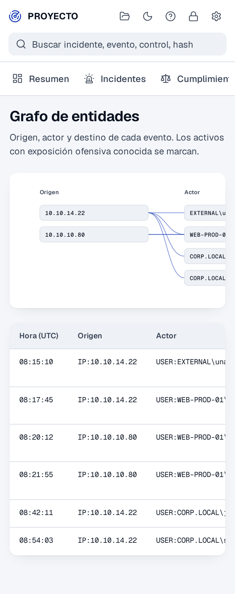

<h1 align="center">PROYECTO</h1>

<p align="center">
  <b>Correlador local de evidencias: une los hallazgos de un pentest, la telemetría del SOC y los dictámenes de cumplimiento (ENS, ISO/IEC 27001, NIS2) en un único paquete sellado con SHA-256 y árboles de Merkle.</b>
</p>

<p align="center">
  <a href="LICENSE"></a>
  
  
  
  
  
  
  
  
</p>

<p align="center">
  
</p>

Un pentest encuentra una cuenta de servicio con RC4 habilitado. Semanas después el SOC ve una petición TGS y un inicio de sesión WinRM. Auditoría pregunta si se cumple el control op.acc.5 del ENS. Normalmente son tres informes distintos. PROYECTO los une:

1. **Ofensiva.** Hallazgos de auditoría (BloodHound, LinPEAS, Burp Suite, SQLMap) que describen la exposición conocida de cada activo.
2. **Detección y DFIR.** Eventos de Windows (EVTX), Linux (auditd) y servidores web, normalizados al esquema `UnifiedEvidenceEvent` v1 (inspirado en OCSF/ECS).
3. **GRC.** Cada incidente correlacionado genera no conformidades sobre el **ENS (RD 311/2022)**, la **ISO/IEC 27001:2022** y la **Directiva NIS2**, con la evidencia que las sustenta.

Cada evento crudo se sella con SHA-256 y se encadena al anterior; cada incidente lleva la raíz de Merkle de sus evidencias. Si alguien modifica un log, un sello o el paquete exportado, la verificación lo detecta y señala el bloque.

Funciona con **Python 3.8+ y solo la librería estándar**. La consola web es un HTML estático: se abre con doble clic (`file://`), sin servidor y sin conexión.

---

## Índice

- [Arranque rápido](#arranque-rápido)
- [Cómo funciona](#cómo-funciona)
- [Cadena de custodia](#cadena-de-custodia)
- [Reglas de correlación](#reglas-de-correlación)
- [Consola web](#consola-web)
- [Capturas](#capturas)
- [CLI](#cli)
- [Calidad](#calidad)
- [Seguridad y privacidad](#seguridad-y-privacidad)
- [Limitaciones conocidas](#limitaciones-conocidas)
- [Estructura](#estructura)
- [Cambio de nombre](#cambio-de-nombre)
- [Historial de versiones](#historial-de-versiones)
- [Licencia](#licencia)
- [Autor y contribuciones](#autor-y-contribuciones)

---

## Arranque rápido

```bash
git clone <url-del-repositorio> && cd <carpeta>

# 1. Correlacionar los datos de ejemplo y exportar el paquete de evidencias
python3 -m proyecto run --dashboard-js docs/data/bundle.js

# 2. Verificar el paquete exportado (cadena, eventos crudos y raíces de Merkle)
python3 -m proyecto verify output/correlated_evidence_bundle.json

# 3. Abrir la consola web
xdg-open docs/index.html        # Linux / Kali
open docs/index.html            # macOS

# 4. Pruebas
python3 -m unittest discover -s tests -t .
```

Con tus propios datos:

```bash
python3 -m proyecto run \
  --events mis_eventos.json \
  --findings hallazgos_pentest.json \
  --rules reglas/ \
  -o output/caso-2026-10.json \
  --dashboard-js docs/data/bundle.js
```

También se instala como comando: `pip install .` y después `proyecto run`.

## Cómo funciona



1. **Normalización.** Cada evento se lleva al esquema común (actor, origen, destino, proceso o artefacto) y se enriquece con los hallazgos ofensivos del mismo activo. Un hallazgo con SPN o binario concreto solo se asocia a eventos sobre ese SPN o binario; uno genérico, a cualquier evento del host.
2. **Sellado.** Antes de correlacionar, el evento crudo se serializa de forma canónica y se encadena en la cadena de custodia.
3. **Correlación.** Cada regla es una máquina de estados: un evento que cumple la etapa 1 abre un estado por grupo (`group_by`), los eventos posteriores lo hacen avanzar y, si la secuencia se completa dentro de la ventana, se emite un incidente.
4. **Cumplimiento.** El incidente hereda las técnicas MITRE ATT&CK y los controles de la regla; el paquete agrega las no conformidades por marco y enlaza cada una con sus incidentes.

## Cadena de custodia



- **Hash del evento.** `SHA-256(json.dumps(evento, sort_keys=True, separators=(",", ":"), ensure_ascii=False))`.
- **Sello.** `SHA-256(sello_anterior | hash_evento | instante_de_ingesta)`. El primer bloque enlaza con un génesis fijo que **no depende del nombre de la herramienta**, para que un cambio de nombre no invalide paquetes anteriores.
- **Merkle.** Esquema de RFC 6962: prefijo `0x00` en hojas y `0x01` en nodos internos, y el nodo impar se promueve sin duplicarse (evita colisiones del tipo CVE-2012-2459).
- **Qué detecta `verify`.** Un sello alterado, un enlace roto, bloques reordenados, un evento crudo modificado, la eliminación del último bloque (comparando con el sello final registrado) y la sustitución de la raíz de Merkle de un incidente.

## Reglas de correlación

Una regla por fichero JSON en `proyecto/rules/` (o el directorio que pases con `--rules`). Con PyYAML instalado también se aceptan `.yaml`. Las reglas se validan al cargarse: campos obligatorios, severidad, confianza entre 0 y 1, ventana, identificadores de etapa únicos y predicados conocidos.

```json
{
  "id": "CORR-AD-001",
  "title": "Kerberoasting seguido de movimiento lateral WinRM/SMB",
  "severity": "CRITICAL",
  "confidence": 0.96,
  "correlation": {
    "type": "temporal_sequence",
    "window": "45m",
    "group_by": ["target_service_account"],
    "stages": [
      {
        "stage_id": "stage_1_tgs_request",
        "source_type": "windows_evtx",
        "match": { "event.NativeEventID": 4769, "process_or_artifact.EffectiveTicketEncryption": "0x17" },
        "posture_condition": { "offensive_posture_context.known_exposures.finding_id": "AD-SPN-RC4-001" },
        "extract": { "attacker_ip": "source.ip", "target_service_account": "target.target_user_or_spn" }
      },
      {
        "stage_id": "stage_2_lateral_movement",
        "source_type": "windows_evtx",
        "match": { "event.NativeEventID": [4624, 5140], "event.LogonType": 3,
                   "actor.user_name": "$stage_1_tgs_request.target_service_account" },
        "predicates": {
          "equals_ref": { "source.ip": "$stage_1_tgs_request.attacker_ip" },
          "field_in_list": { "target.port": [5985, 5986, 445] }
        }
      }
    ]
  },
  "mitre_attack": [{ "tactic": "Credential Access", "technique_id": "T1558.003", "technique_name": "Kerberoasting" }],
  "grc_compliance_mapping": {
    "ens_rd_311_2022": [{ "control_id": "op.acc.5", "control_name": "Mecanismo de autenticación", "audit_verdict": "NO_CONFORME_CRITICO", "evidence_summary": "…" }],
    "iso_27001_2022": [{ "control_id": "A.8.5", "control_name": "Secure authentication", "audit_verdict": "NON_CONFORMITY_MAJOR" }],
    "nis2_directive": [{ "article": "Art. 21.2(i) y (j)", "topic": "Control de acceso y autenticación segura" }]
  }
}
```

| Elemento | Significado |
|---|---|
| `window` | Tiempo máximo entre la primera y la última etapa: `120s`, `45m`, `2h`, `1d`. Un formato desconocido es un error, no un valor por defecto. |
| `group_by` | Variables extraídas o rutas del evento que identifican una secuencia. Hay un estado abierto por grupo, así que un mismo ataque no genera incidentes duplicados. |
| `match` | Igualdad por ruta con punto. Una lista significa «cualquiera de». `$etapa.variable` referencia un valor extraído. La comparación tolera tipos (`"5985"` = `5985`). |
| `posture_condition` | Exige que el activo tenga ese hallazgo ofensivo conocido. |
| `extract` | Guarda valores del evento para etapas posteriores (`variable` y `etapa.variable`). |
| `field_contains_any` | Subcadenas, sin distinguir mayúsculas. |
| `equals_ref` / `not_equals` / `field_in_list` | Igual a una variable, distinto de un valor, dentro de una lista. |
| `require_suid_or_capabilities` | Bit SUID o capability peligrosa (`cap_setuid`, `cap_sys_admin`, …; se ignora el sufijo `+ep`). |

Reglas incluidas:

| Id | Secuencia | MITRE ATT&CK | ENS |
|---|---|---|---|
| `CORR-AD-001` | TGS con RC4 sobre cuenta con SPN expuesto → inicio de sesión de red (tipo 3) por WinRM o SMB desde la misma IP | T1558.003, T1021.006 | op.acc.5, op.acc.6 |
| `CORR-LNX-002` | Enumeración de SUID y capabilities sin privilegios → transición a euid 0 con un binario explotable | T1083, T1548.001 | op.exp.2, mp.sw.2 |
| `CORR-WEB-003` | Inyección SQL con respuesta 200 en el login → `www-data` ejecuta comandos en el mismo host | T1190, T1059.004 | mp.s.2 |

## Consola web

`docs/index.html` lee `docs/data/bundle.js` (los navegadores bloquean `fetch()` en `file://`, por eso el paquete se escribe también como script). Para revisar otro paquete basta con **Abrir** o arrastrarlo a la ventana.

| Sección | Qué muestra |
|---|---|
| **Resumen** | Eventos sellados, incidentes, no conformidades, estado de la custodia, cronología del ataque y tácticas MITRE ATT&CK. |
| **Incidentes** | Etapas encadenadas con comando, exposición ofensiva y hash de cada evento; técnicas; dictamen por marco; raíz de Merkle. |
| **Cumplimiento** | No conformidades por marco (ENS, ISO/IEC 27001, NIS2) con la evidencia y los incidentes; exportación a CSV con protección contra inyección de fórmulas. |
| **Custodia** | Verificación en el navegador de todos los sellos, del hash de cada evento crudo y de la raíz de Merkle, y un botón para **simular una manipulación** y ver cómo se detecta. |
| **Eventos** | Tabla filtrable de eventos normalizados con el JSON completo de cada uno. |
| **Grafo** | Origen → actor → destino de cada evento, con los activos expuestos marcados, y la misma información en tabla. |

Barra superior: búsqueda global (`/`), abrir paquete, tema claro u oscuro, atajos, ayuda, privacidad, ajustes (tema, color de acento, densidad) e indicador de funcionamiento local.

| Atajo | Acción |
|---|---|
| `/` | Buscar incidentes, eventos, controles o hashes |
| `1`–`6` | Ir a una sección |
| `J` / `K` | Incidente siguiente / anterior |
| `V` | Verificar la cadena de custodia |
| `T` | Alternar tema |
| `O` | Abrir un paquete JSON |
| `?` | Atajos |

**GitHub Pages.** La consola está en `docs/`: en *Settings → Pages* elige la rama principal y la carpeta `/docs`. Publica solo paquetes de ejemplo; un paquete real contiene logs de la organización.

## Capturas

Generadas con `python3 scripts/screenshots.py` (Playwright, Chromium headless).

| Sección | Claro | Oscuro | Móvil |
|---|---|---|---|
| Resumen |  |  |  |
| Incidentes |  |  |  |
| Cumplimiento |  |  |  |
| Custodia |  |  |  |
| Eventos |  |  |  |
| Grafo |  |  |  |

## CLI

```text
python3 -m proyecto run     [--events F] [--findings F] [--rules DIR|F] [-o SALIDA]
                            [--dashboard-js RUTA] [--no-raw] [--json] [--color auto|always|never]
python3 -m proyecto verify  PAQUETE.json [--json]
python3 -m proyecto rules   [--rules DIR|F]
```

- Sin subcomando equivale a `run` con los datos de ejemplo.
- Códigos de salida: `0` correcto, `1` error de entrada (fichero, JSON o regla no válidos), `2` integridad comprometida.
- El color se desactiva fuera de una terminal y con `NO_COLOR`.
- `--no-raw` exporta el paquete sin los eventos crudos (más ligero, pero `verify` ya no puede comprobarlos).

## Calidad

| Conjunto | Qué cubre |
|---|---|
| `tests/test_custody.py` | Merkle (vacío, orden, nodo impar, separación de dominio), enlaces, sellos, manipulación de hash, instante, evento crudo, reordenación y truncado |
| `tests/test_normalizer.py` | Esquema, campos por fuente, contexto ofensivo por SPN, binario y host, valores por defecto, marcas de tiempo no válidas |
| `tests/test_correlator.py` | Las tres reglas, ventana, orden, zonas horarias, referencias, postura, cifrado fuerte, puertos como texto, SUID y capabilities, sin duplicados, grupos independientes, reglas de una etapa |
| `tests/test_rules.py` | Carga, validación y duplicados |
| `tests/test_pipeline_cli.py` | Paquete, `verify` con manipulaciones, script del dashboard seguro, CLI y `python -m` sin avisos |
| `tests/test_static.py` | Consola sin recursos remotos, CSP estricta, sin fondos con patrón, iconos existentes, datos de ejemplo al día, sin atribuciones ni nombre descartado, `rename.sh` de extremo a extremo |
| `tests/browser/` | axe-core en las seis vistas y los diálogos, en claro, oscuro y móvil; solo peticiones locales; verificación y simulación de manipulación; teclado; un paquete con HTML no se ejecuta |

Las pruebas de navegador se omiten si Playwright no está instalado (`pip install playwright && python3 -m playwright install chromium`). La CI ejecuta el resto en Python 3.8, 3.9, 3.10, 3.11 y 3.12, con acciones fijadas por SHA.

## Seguridad y privacidad

- **Sin red.** La consola declara `default-src 'none'`; scripts, estilos, fuentes (Geist, OFL) e iconos (Lucide, ISC) están en el repositorio. No hay CDN, analítica ni cookies.
- **Datos no confiables.** Todo lo que viene de un paquete se inserta con `textContent`; nunca como HTML. El paquete incrustado escapa `</` para no cerrar la etiqueta `<script>`.
- **CSV.** Las celdas que empiezan por `=`, `+`, `-`, `@` se neutralizan.
- **Preferencias.** Solo tema, acento y densidad se guardan en `localStorage`.

Más detalles y cómo informar de una vulnerabilidad en [SECURITY.md](SECURITY.md).

## Limitaciones conocidas

- La correlación trabaja sobre ficheros JSON ya exportados; no hay conectores en vivo con SIEM ni con EDR.
- El sello registra el instante de ingesta, así que dos ejecuciones sobre los mismos datos producen sellos distintos (las raíces de Merkle de los eventos e incidentes sí coinciden).
- La verificación del navegador recalcula el hash de los eventos crudos con una serialización equivalente a la de Python; con números en coma flotante que JavaScript representa distinto (por ejemplo `1.0`) puede dar un falso positivo. La referencia es `verify` en la CLI.
- La cadena demuestra integridad, no autoría: no hay firma asimétrica del paquete. Para eso, firma el JSON exportado (por ejemplo con `minisign` o `gpg --detach-sign`) o ancla el sello final en un sistema externo.
- Los mapeos a ENS, ISO/IEC 27001 y NIS2 de las reglas de ejemplo son orientativos y deben revisarse con el auditor.

## Estructura

```text
.
├── proyecto/                     # paquete Python (solo librería estándar)
│   ├── branding.py               # nombre visible, slug y autor: único lugar donde se define
│   ├── cli.py · __main__.py      # CLI: run, verify, rules
│   ├── pipeline.py               # orquestación, resumen GRC, verificación de paquetes
│   ├── normalizer.py             # esquema UnifiedEvidenceEvent v1 + contexto ofensivo
│   ├── correlator.py             # motor FSM multi-etapa y grafo de entidades
│   ├── custody.py                # cadena SHA-256 y Merkle (RFC 6962)
│   ├── rules.py · timeutil.py    # carga y validación de reglas; tiempo compatible con 3.8
│   ├── rules/                    # reglas incluidas (JSON)
│   └── sample_data/              # hallazgos y telemetría de ejemplo
├── docs/                         # consola web (también para GitHub Pages)
│   ├── index.html
│   ├── assets/                   # app.js, app.css, sha256.js, fuentes e iconos vendorizados
│   ├── data/bundle.js            # paquete de ejemplo generado por la CLI
│   └── img/                      # capturas
├── tests/                        # unittest (compatible con pytest) + tests/browser
├── scripts/                      # rename.sh, screenshots.py, vendor_icons.py
└── .github/workflows/ci.yml
```

## Cambio de nombre

El nombre definitivo está pendiente. Mientras tanto se usa el marcador `PROYECTO` (nombre visible) y `proyecto` (paquete y comando). Para cambiarlo:

```bash
scripts/rename.sh --dry-run ARGOS      # muestra qué ficheros y rutas cambiarían
scripts/rename.sh ARGOS                # PROYECTO -> ARGOS, proyecto -> argos
scripts/rename.sh "Mi Nombre" minombre # slug explícito
```

Sustituye el marcador en código, README, consola, banner de la CLI y `pyproject.toml`, y renombra la carpeta del paquete. Después regenera los datos del dashboard y las capturas (el script indica los comandos). Una prueba ejecuta el cambio de nombre sobre una copia del repositorio y comprueba que todo sigue funcionando.

## Historial de versiones

| Versión | Fecha | Cambios |
|---|---|---|
| 0.1.0 | octubre de 2026 | Primera versión pública: paquete instalable, CLI con `run`, `verify` y `rules`, Merkle RFC 6962, verificación de eventos crudos y truncado, `group_by` efectivo, consola accesible en claro y oscuro, 94 pruebas más 6 de navegador. Detalle en [CHANGELOG.md](CHANGELOG.md). |

## Licencia

[GNU General Public License v2.0](LICENSE). Fuentes Geist bajo SIL Open Font License 1.1 (`docs/assets/fonts/OFL-geist.txt`); iconos Lucide bajo ISC (`docs/assets/vendor/LICENSE-lucide.txt`); axe-core (solo pruebas) bajo MPL-2.0.

## Autor y contribuciones

<table>
<tr>
<td align="center" width="100%" valign="top">
<b>Yoandy Ramírez Delgado</b><br/>
<sub><b>Diseño y desarrollo</b></sub><br/>
<sub>Junior Pentester · eJPTv2 · GRC · SysAdmin</sub><br/><br/>
<a href="https://www.linkedin.com/in/yoandyrd92/"></a>
<a href="https://github.com/heindall92"></a>
<a href="https://yoandyramirez.com"></a>
</td>
</tr>
</table>

Las contribuciones son bienvenidas: lee [CONTRIBUTING.md](CONTRIBUTING.md) antes de abrir una *pull request*.
